<!-- Profile README · emonaxc · neon cyan → violet on #0D1117 -->

<div align="center">
  
</div>

<div align="center">
  <a href="https://github.com/emonaxc">
    
  </a>
</div>

<div align="center">
  
  
  
</div>

<div align="center">
  
</div>

## 👨‍💻 Who I Am

> **Developer · Builder · Tech Enthusiast** — I turn ideas into real-world projects.

I build web applications, smart bots, automation tools and the backends that keep
them running. Most of my time goes into making systems talk to each other —
APIs, queues, providers, dashboards — and making them survive real traffic.

| | |
|---|---|
| 🚀 **Building** | Web applications, smart bots, automation tools, digital solutions |
| 💻 **Exploring** | JavaScript · Node.js · PHP · MySQL · HTML · CSS |
| 🤖 **Interested in** | AI, API integrations, bots, backend development |
| ⚡ **Approach** | Prototype fast, ship clean, automate the boring parts |

```ts
const emonaxc = {
  role: 'Developer & Builder',
  stack: ['JavaScript', 'Node.js', 'PHP', 'MySQL', 'HTML', 'CSS'],
  focus: ['AI', 'API integrations', 'Bots', 'Backend'],
  motto: 'Code • Build • Integrate • Innovate',
  status: 'Turning ideas into real-world projects',
}
```

<div align="center">
  
</div>

## 🧰 Tech I Work With

<div align="center">
  
</div>

<div align="center">
  
  
  
  
  
  
</div>

<div align="center">
  
</div>

## 📊 GitHub Stats

<div align="center">
  
</div>

<div align="center">
  
  
</div>

<div align="center">
  
</div>

<div align="center">
  
</div>

<div align="center">
  <picture>
    <source media="(prefers-color-scheme: dark)" srcset="https://raw.githubusercontent.com/emonaxc/emonaxc/output/github-contribution-grid-snake-dark.svg" />
    <source media="(prefers-color-scheme: light)" srcset="https://raw.githubusercontent.com/emonaxc/emonaxc/output/github-contribution-grid-snake.svg" />
    
  </picture>
</div>

<div align="center">
  
</div>

## 🤝 Let's Connect

<div align="center">
  <a href="https://github.com/emonaxc">
    
  </a>
  <a href="https://github.com/emonaxc?tab=repositories">
    
  </a>
</div>

<div align="center">
  
</div>

<div align="center">
  
</div>
